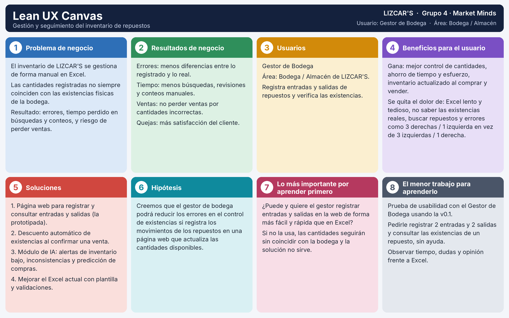

# 05 · Canvas del proyecto

## Bloques del Lean UX Canvas

| # | Bloque | Respuesta del equipo |
|---|---|---|
| 1 | **Problema de negocio:** ¿qué le pasa a la organización con el proceso que eligieron? | En LIZCAR'S (compra y venta de repuestos para carros), la gestión del inventario se hace de forma manual en Excel. Las cantidades registradas no siempre coinciden con las existencias físicas de la bodega, lo que genera errores, pérdida de tiempo en búsquedas y conteos manuales, y riesgo de perder ventas por no saber con exactitud qué hay disponible. |
| 2 | **Resultados de negocio:** ¿qué mejora en la organización si se resuelve? (tiempo, costos, errores, quejas, ventas) | **Errores:** menos diferencias entre lo registrado y lo que realmente hay en bodega. **Tiempo:** menos horas en búsquedas, revisiones de registros anteriores y conteos manuales. **Ventas:** se evita perder ventas por cantidades incorrectas. **Quejas:** mayor satisfacción del cliente al confirmar disponibilidad real. |
| 3 | **Usuarios:** ¿quién es el usuario? Cargo y área. | Gestor de Bodega, del área de Bodega / Almacén de LIZCAR'S. Es quien registra las entradas y salidas de los repuestos y verifica las existencias. |
| 4 | **Beneficios para el usuario:** ¿qué gana y qué dolor le quita? (sale del mapa de empatía) | **Gana:** mejor control de las cantidades del almacén, ahorro de tiempo y esfuerzo al registrar entradas y salidas, e inventario actualizado en el momento de la compra o la venta. **Dolor que se le quita:** la gestión lenta y tediosa en Excel, no conocer con exactitud las existencias reales, el tiempo perdido buscando repuestos y los errores de cantidades (por ejemplo, un producto registrado con 3 derechas y 1 izquierda cuando en realidad eran 3 izquierdas y 1 derecha). |
| 5 | **Soluciones:** mínimo 3 ideas que podrían resolver el problema. | 1. **Página web para registrar y consultar entradas y salidas de repuestos**, que actualiza las cantidades disponibles (la que prototipamos). 2. **Descuento automático de existencias** cuando se confirma una venta, conectando el sistema web con el proceso de ventas. 3. **Módulo de inteligencia artificial** que detecte posibles inconsistencias, genere alertas de inventario bajo y prediga necesidades de compra. 4. **Mejorar el Excel actual** con una plantilla estandarizada y validaciones (opción de menor costo). |
| 6 | **Hipótesis:** copien la hipótesis de `docs/07-prototipo.md`. | Creemos que el gestor de bodega podrá reducir los errores en el control de existencias si registra los movimientos de los repuestos en una página web que actualiza las cantidades disponibles. |
| 7 | **Lo más importante por aprender primero:** lo que, si sale mal, hace que la solución no sirva. | Si el gestor de bodega no logra registrar los movimientos en la página web de forma más fácil y rápida que en Excel, no la va a usar, y las cantidades seguirán sin coincidir con la bodega. Por eso lo primero es saber si **puede y quiere usarla** para registrar entradas y salidas y consultar existencias sin dificultad. |
| 8 | **El menor trabajo para aprenderlo:** la prueba más sencilla con el usuario usando la v0.1. | **Prueba de usabilidad** con el Gestor de Bodega usando la v0.1: pedirle que registre 2 entradas y 2 salidas de ejemplo y que consulte las existencias de un repuesto, sin ayuda. Observar cuánto tarda, dónde se confunde y qué opina frente a Excel. Opcional: comparar lo que muestra la página con un conteo físico de unos pocos repuestos. |
