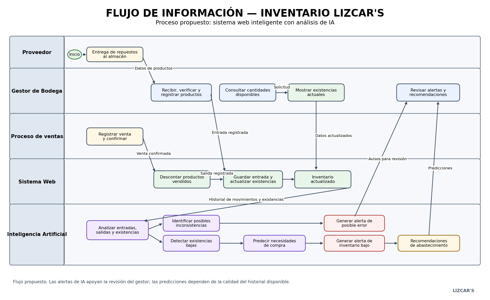

06. Solución propuesta – LIZCAR'S
1. Información de la organización
Organización: LIZCAR'S
Actividad económica: Compra y venta de repuestos para vehículos.
Contacto: Fernando Ramírez.
Cargo: Gerente General.
Referencia: Daniel Ramírez.
Usuario del proceso: Gestor de Bodega.
Proceso: Gestión y seguimiento del inventario del almacén.
2. Problema identificado

En LIZCAR'S, el gestor de bodega necesita gestionar correctamente el inventario, debido a que actualmente el registro de entradas y salidas de los repuestos se realiza de manera manual. Esta situación puede ocasionar errores en las cantidades registradas y dificulta conocer con exactitud las existencias disponibles en el almacén.

3. Solución propuesta

LIZCAR'S implementará un sistema web inteligente para gestionar el inventario de repuestos de vehículos.

El gestor de bodega podrá registrar digitalmente las entradas de productos y consultar las existencias.

Al realizar una venta, el sistema descontará automáticamente las cantidades correspondientes.

La inteligencia artificial analizará el inventario para detectar posibles errores, generar alertas y predecir necesidades de compra.

Esto permitirá reducir errores manuales, mejorar el control de existencias y facilitar la toma de decisiones.

4. Flujo de información
Entrada	Proceso	Responsable	Salida
Repuestos recibidos y datos de productos	Verificar y registrar los repuestos	Gestor de Bodega	Entrada registrada
Información de la entrada	Actualizar cantidades disponibles	Sistema Web	Inventario actualizado
Información de una venta confirmada	Descontar automáticamente los productos vendidos	Sistema Web	Inventario actualizado
Solicitud de consulta	Consultar cantidades disponibles	Gestor de Bodega	Existencias actuales
Datos de entradas, salidas y existencias	Analizar movimientos e identificar inconsistencias	Inteligencia Artificial	Posibles errores identificados
Cantidades disponibles	Identificar productos con pocas existencias	Inteligencia Artificial	Alertas de inventario bajo
Historial de ventas y movimientos	Analizar tendencias y predecir necesidades de compra	Inteligencia Artificial	Predicciones y recomendaciones
5. Comparación del proceso actual y el proceso propuesto
Antes (proceso actual)	Después (solución propuesta)
Los registros se realizan manualmente.	Los registros se realizan mediante un sistema web.
Pueden presentarse errores al registrar cantidades.	El sistema actualiza automáticamente las existencias.
Se dificulta conocer las cantidades reales disponibles.	El gestor puede consultar el inventario actualizado.
Las salidas se controlan manualmente.	Las ventas confirmadas descuentan automáticamente los productos.
No existe análisis inteligente del inventario.	La IA identifica posibles inconsistencias y patrones.
Es difícil anticipar cuándo comprar repuestos.	La IA genera alertas y predicciones de necesidades de compra.
6. Responsables del proceso
Proveedor: entrega los repuestos al almacén.
Gestor de Bodega: recibe, verifica y registra las entradas; consulta el inventario y revisa las alertas.
Sistema Web: almacena la información, actualiza las existencias y descuenta automáticamente los productos vendidos.
Inteligencia Artificial: analiza los movimientos, identifica posibles inconsistencias, genera alertas y realiza predicciones.
Proceso de ventas: comunica las ventas confirmadas al sistema de inventario para realizar los descuentos correspondientes.
7. Resultado esperado

Con la implementación del sistema web inteligente, LIZCAR'S podrá mejorar la gestión y seguimiento del inventario, reducir los errores ocasionados por los registros manuales, conocer las existencias disponibles y anticipar las necesidades de abastecimiento mediante inteligencia artificial.

8. Consideraciones

El registro de entradas se propone inicialmente de manera digital por parte del gestor de bodega. La integración con el proceso de ventas deberá definirse de acuerdo con el funcionamiento de la empresa.

Las predicciones y alertas de inteligencia artificial dependerán de la disponibilidad y calidad de los datos históricos del inventario.

## Diagrama de flujo de información

