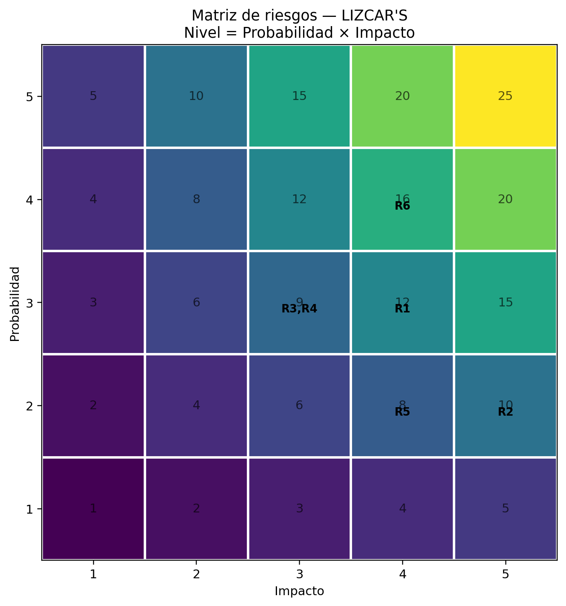

# 09 · Gestión de riesgos — LIZCAR'S

## Objetivo

Identificar, valorar y proponer tratamientos para los riesgos asociados a la implementación del sistema web inteligente de gestión del inventario de repuestos de LIZCAR'S.

## Contexto

La solución propuesta permitirá al Gestor de Bodega registrar digitalmente las entradas, consultar las existencias y mantener actualizado el inventario. Las ventas confirmadas deberán comunicar sus movimientos al sistema para descontar las unidades correspondientes. La solución también contempla análisis mediante inteligencia artificial para identificar posibles inconsistencias, generar alertas y apoyar la predicción de necesidades de compra.

## Escala de valoración

- Probabilidad: de 1 (muy baja) a 5 (muy alta).
- Impacto: de 1 (muy bajo) a 5 (muy alto).
- Nivel de riesgo = Probabilidad × Impacto.
- Clasificación: Bajo (1–4), Medio (5–9), Alto (10–16) y Crítico (20–25).

Las valoraciones son estimaciones iniciales propuestas para el análisis del proyecto; deben ser revisadas y aprobadas por el equipo.

## Matriz de riesgos

| ID | Categoría | Riesgo | P | I | Nivel | Tratamiento y acción | Responsable |
|---|---|---|---:|---:|---|---|---|
| R1 | Tecnológico | Falla del sistema web que impida registrar o consultar el inventario. | 3 | 4 | 12 - Alto | Mitigar: realizar pruebas antes de cada actualización, mantener copias de seguridad y definir un registro temporal mientras se restablece el servicio. | Equipo del proyecto / responsable técnico |
| R2 | Ciberseguridad | Acceso de personas no autorizadas a la información del inventario. | 2 | 5 | 10 - Alto | Mitigar: utilizar contraseñas seguras, limitar los permisos según el usuario y realizar copias de seguridad periódicas. | Equipo del proyecto / administrador del sistema |
| R3 | Personas y adopción | El gestor de bodega puede tener dificultades para adaptarse al uso del sistema web. | 3 | 3 | 9 - Medio | Mitigar: realizar una capacitación práctica, entregar una guía sencilla y acompañar al gestor durante los primeros usos. | Gestor de Bodega y equipo del proyecto |
| R4 | Financiero | Los costos de alojamiento, mantenimiento o licencias pueden superar el presupuesto disponible. | 3 | 3 | 9 - Medio | Mitigar: revisar los costos antes de implementar la solución, priorizar herramientas acordes con el presupuesto y hacer seguimiento a los gastos. | Gerencia / equipo del proyecto |
| R5 | Legal | El sistema podría manejar datos personales sin aplicar las medidas de protección correspondientes. | 2 | 4 | 8 - Medio | Mitigar: recopilar únicamente los datos necesarios, restringir el acceso y revisar el cumplimiento de la Ley 1581 de 2012 y las reglas aplicables. | Gerencia / responsable del tratamiento de datos |
| R6 | Operativo | Si las ventas confirmadas no se comunican correctamente al sistema, las existencias pueden quedar desactualizadas. | 4 | 4 | 16 - Alto | Mitigar: definir cómo se informan las ventas al sistema, verificar los descuentos y comparar periódicamente las existencias registradas con las reales. | Proceso de ventas y Gestor de Bodega |

## Mapa de calor

## Seguimiento

- Revisar los riesgos durante el desarrollo y antes de poner en funcionamiento el sistema.
- Actualizar la probabilidad y el impacto cuando cambien las condiciones del proyecto.
- Comprobar que las acciones de tratamiento se hayan realizado y registrar cualquier riesgo nuevo.

## Consideraciones

La integración con el proceso de ventas aún debe definirse de acuerdo con el funcionamiento de LIZCAR'S. Por eso, el riesgo R6 debe revisarse cuando se establezca cómo se comunicarán las ventas confirmadas al sistema. Las alertas y predicciones de inteligencia artificial también dependerán de la disponibilidad y calidad de los datos históricos del inventario.

